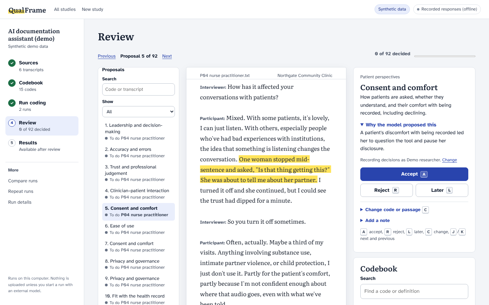

# QualFrame

**AI-assisted directed content analysis you can check.**

QualFrame applies your codebook to interview transcripts with a large language model, then puts every proposed code beside the exact passage it came from so you can accept, change or reject it. It runs on your own computer, works with hosted or local models, and keeps a full record of what the model proposed and what you decided.



*The review screen in the built-in demo study: fictional interviews, coded by Claude Sonnet 5.5 (a recorded run from October 2026).*

## What it does

- **Codes transcripts against your codebook.** Import a codebook from Excel (flat or hierarchical), add Word or text transcripts, and choose a model. CFIR is included as a reference workflow.
- **Shows every proposal with its evidence.** Each proposed code is located in the transcript by its exact quotation. Quotations the model changed or invented can't be located, so they are flagged for you instead of being quietly accepted.
- **Keeps you in charge.** Accept, change the code or passage, reject, or leave a proposal for later, using the keyboard if you like. Your decisions are saved as new records; the model's original output is never overwritten.
- **Summarises what you kept.** See codes by transcript and site, read the passages behind any count, and export to Excel.
- **Compares runs.** Code the same study with two models, or the same model twice, and see where they agree and which passages only one of them coded.
- **Records everything needed to report it.** Transcript and codebook hashes, prompt versions, model settings, costs and every review decision are kept with the study.

## Try it

You need Windows, macOS or Linux. No Python setup is required.

1. [Download QualFrame](https://github.com/ZvanAllen/qualframe/archive/refs/heads/main.zip) and unzip it, or clone the repository.
2. Start it:
   - **Windows:** double-click `Start QualFrame.bat`.
   - **macOS:** double-click `start-qualframe.command`. If macOS blocks it, right-click it and choose **Open** the first time.
   - **Linux:** run `./start-qualframe.command` in a terminal.

   The first start installs [uv](https://docs.astral.sh/uv/) and Python 3.12 (a few minutes). Later starts take a few seconds.
3. Your browser opens QualFrame. Choose **Open the demo study** to look around with six fictional interviews. The demo runs entirely offline.

Keep the start window open while you work, and close it to stop QualFrame.

<details><summary>Prefer the command line?</summary>

```bash
uv run --python 3.12 --extra llm qualframe start
```

or with pip in a Python 3.11+ environment:

```bash
pip install -e ".[llm]"
qualframe start            # add --workspace PATH to choose where studies are saved
```
</details>

## Use it with your own study

1. **New study.** Name it and say whether it holds de-identified, sensitive, or test data.
2. **Sources.** Drop in your transcripts (.docx or .txt). Optionally add a CSV of participant information, such as site or role, to compare groups later.
3. **Codebook.** Import an Excel sheet and match its columns to code name, definition, parent code, and inclusion and exclusion guidance. [An example codebook](demo/datasets/ai-scribe/codebook.xlsx) shows the layout.
4. **Run coding.** Pick a model, check the estimated cost, and start. Hosted models need an API key; local models don't.
5. **Review, then Results.** Decide on each proposal, then explore and export your reviewed coding.

The [getting started guide](docs/getting-started.md) walks through each step, and the [user guide](docs/guide.md) covers the details.

## Models and your data

QualFrame works with OpenAI and Anthropic models, any OpenAI-compatible endpoint (including **Azure OpenAI**), and **local models** through [Ollama](https://ollama.com) or [LM Studio](https://lmstudio.ai), which keep transcripts on your computer and cost nothing to run.

Your studies are stored in a `QualFrame` folder in your home directory, outside the application folder. Nothing leaves your computer until you start a coding run with a hosted model, and then only the transcripts, codebook and instructions for that run are sent to the provider you chose. Check that your ethics approval and data agreements allow this before using a hosted model with real data. [Models and data](docs/models-and-data.md) explains the options, costs and where each file goes.

As a guide to cost, coding the six short demo interviews (about 4,100 words) with Claude Sonnet 5.5 cost $0.22 in October 2026, most of it the model's hidden reasoning; a low-cost model such as Claude Haiku 5.5 or GPT-6 Luna costs about a cent. An hour-long interview costs very roughly 15 to 25 cents with a mid-priced model.

## What QualFrame claims, and what it doesn't

QualFrame is research software for **directed (deductive) content analysis** with a human reviewing every proposal. It does not do inductive or thematic analysis for you, and it does not write findings. Agreement between runs describes consistency, not accuracy: neither the model nor a second run is treated as correct. Whether model-assisted coding is good enough for your study is a methodological judgement that QualFrame helps you make and document, not one it makes for you.

## For researchers

QualFrame grew out of the AI-assisted CFIR analysis in the Adaptive Mentorship Networks (AMN) study. Two papers about that work are in preparation: one on developing the human-in-the-loop workflow and its prompt library, and one evaluating model performance. The CFIR prompts from that work are in [`prompts/cfir/final`](prompts/cfir/final).

If you use QualFrame, please cite it (see [CITATION.cff](CITATION.cff) or GitHub's **Cite this repository**). [Reporting QualFrame in your methods](docs/reporting.md) includes a template paragraph and the details reviewers usually ask about.

## Contributing

Bug reports, feature ideas and pull requests are welcome. See [CONTRIBUTING.md](CONTRIBUTING.md) and the [development notes](docs/development.md). Never attach real transcripts or API keys to an issue.

## Licence

MIT. Copyright © 2026 Zack van Allen. Bundled fonts (Atkinson Hyperlegible and Literata) are under the SIL Open Font License. Framework materials such as CFIR keep their own terms; QualFrame does not redistribute the CFIR codebook.
