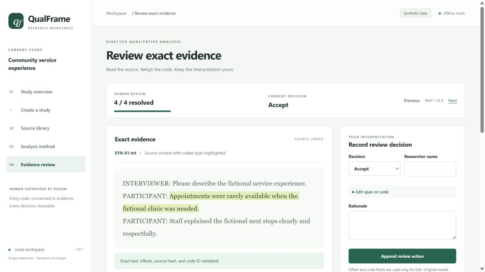
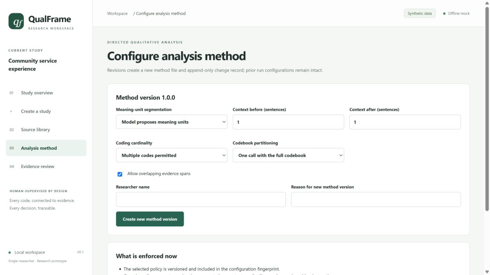
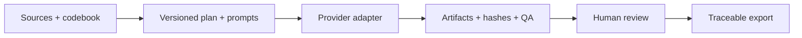

# QualFrame

### AI-assisted qualitative analysis. Evidence-linked. Human-supervised.

QualFrame is a local-first research workspace for **directed qualitative content analysis**: applying a defined codebook to interview material while keeping each coding decision connected to its source evidence.

It combines a working Python workflow engine, versioned analysis configurations, a browser-based evidence reviewer, and traceable exports. CFIR is the first reference workflow; generic directed analysis supports flat and hierarchical codebooks.

**Status:** working, developer-operated research prototype. Not a production service or an autonomous research analyst.



*Actual application screenshot with fictional transcripts and deterministic mock assignments. No participant data or live model results are shown.*

## Why this exists

An AI-generated coding table is not, by itself, an auditable analysis. A researcher still needs to know where a quotation came from, which codebook and prompt were used, what failed validation, and what a human changed.

QualFrame makes those questions part of the workflow. Sources and original outputs are retained; reviewed edits become new records rather than silent replacements. The aim is to support rigorous research judgment—not automate it away.

## Try the working interface

Requires **Python 3.11+**. Run commands from the repository root. Dependency installation needs internet access; the demonstrations do not need API keys or network access.

```bash
python -m venv .venv
```

Activate the environment:

```powershell
# Windows PowerShell
.venv\Scripts\Activate.ps1
```

```bash
# macOS / Linux
source .venv/bin/activate
```

Install and launch:

```bash
python -m pip install -e ".[dev]"
python scripts/run_workspace_demo.py
```

Open [the local evidence reviewer](http://127.0.0.1:8765/evidence?run_id=synthetic-review). The launcher creates a fresh study with **two synthetic transcripts and four source-validated evidence records**. It never overwrites an existing study. Stop the server with `Ctrl+C`.

1. Read the highlighted source span and surrounding context.
2. Inspect the proposed code, its definition, and the mock rationale.
3. Accept, edit, reject, or defer a record with your reasoning.
4. Resolve every record to enable the reviewed-evidence JSON and Excel export.
5. Inspect review history and methods metadata in the export.

The demo demonstrates software behavior, **not coding accuracy**. Each launch creates a new study; the console prints its manifest path. Reopen one with `qualframe serve studies/<study-id>/project.yaml`.



*Core method choices are versioned. Calibration and advanced provider/review-policy editors remain planned.*

## What works today

| Area | Implemented behavior | Boundary |
| --- | --- | --- |
| Study setup | Local studies; hashed TXT/DOCX, YAML codebook, and CSV metadata imports | Bounded formats; no rich codebook designer |
| Reproducibility | Versioned prompts, configuration fingerprints, input/artifact hashes, run manifests | Local file-backed records |
| Execution | Dry runs, filters, resume, five-stage CFIR reference pipeline | Browser-started jobs use mock/cached providers only |
| Evidence review | Exact-span validation; separate context; accept/edit/reject/defer | Generic offset-bearing artifacts; legacy CFIR normalization is planned |
| Quality checks | Deterministic QA, review queues, optional stage/release gates, post-parse validation | Not provider-native constrained generation or proof of analytic quality |
| Usage and cost | Usage ledger, configured pricing, pre-call ceilings and approval pauses | Public pricing fixture is mock-only; SMTP delivery is unverified |
| Export | Excel/JSON evidence packages, review history, methods metadata | No automatic findings or full generated methods appendix |

See the [capability register](docs/capability_status.md) for the implemented/validated/planned distinction.

## A second demo: the CFIR reference pipeline

```bash
python scripts/run_interview_demo.py
```

This cached demonstration exercises five stages: transcript coding → participant roll-up → quote context → network synthesis → cross-network synthesis. It produces **nine artifacts, nine Excel exports, and one deliberately seeded QA conflict**. Open the generated `demo/presentation/index.html` locally for its evidence report.

This is separate from the generic reviewer demo: legacy CFIR tables do not yet expose canonical exact-span review.

## Under the hood



The interface reflects the Python engine's state. Mock/cached adapters exercise the same planning, parsing, QA, provenance, and export paths as configured provider adapters. External-provider use is a separate CLI activity requiring project governance, credentials, pricing, and cost approval.

- [Architecture](docs/architecture.md) — modules, evidence lineage, and tradeoffs.
- [Design decisions](docs/decisions/) — scope, exact evidence, CFIR partitioning, review, and cost.
- [Domain model](docs/domain_model.md) — sources, spans, assignments, versions, and review records.
- [Evaluation and cost control](docs/model_evaluation_and_cost_control.md) — functionality versus methodological validation.
- [Verification record](docs/verification.md) — checks performed on this public snapshot.

## Scope and next steps

Next: human-coded calibration, sequential model comparison, remaining policy editors, review sampling, metadata analysis, and direct text-selection editing. These are roadmap items. See [the roadmap](docs/backlog.md).

The single-user application binds to `127.0.0.1`. **Do not expose it to the internet or use it as a production clinical system.** Local-first storage does not mean an external provider keeps submitted text on your machine. Real studies need their own consent, institutional, retention, and provider approvals.

## Development

```bash
python -m pytest -q
python scripts/run_workspace_demo.py --dry-run
python scripts/run_workspace_demo.py --no-serve
```

Ordinary tests use synthetic fixtures and mock/cached providers. One optional workbook test is skipped when private workbooks are absent. See [contributing](CONTRIBUTING.md) and [privacy and governance](docs/privacy_governance.md). Never attach real transcripts, credentials, or sensitive outputs to an issue.

## Project ownership

An independent project by **Zack van Allen**, developed with AI coding assistance. It combines qualitative research workflow design with reproducible execution, evidence-linked review, and explicit human oversight.

This snapshot excludes research data, private reference workbooks, credentials, internal run reports, and the research checkout's Git history. CFIR prompt wording and framework labels are preserved; CFIR is not presented as a new framework authored by this project.

## License and citation

QualFrame is released under the [MIT license](LICENSE). Copyright © 2026 Zack van Allen. You may use, modify, and redistribute the software, including commercially, subject to the license's notice requirements. Third-party dependencies and framework materials retain their applicable terms.

If you use QualFrame in research, please cite the software using [CITATION.cff](CITATION.cff) or GitHub's **Cite this repository** feature. Citation is requested for scholarly credit; it is not an additional condition of the MIT license.

Suggested citation: van Allen, Z. (2026). *QualFrame: Evidence-linked, human-supervised qualitative analysis* (Version 0.1.0) [Computer software]. https://github.com/ZvanAllen/qualframe
