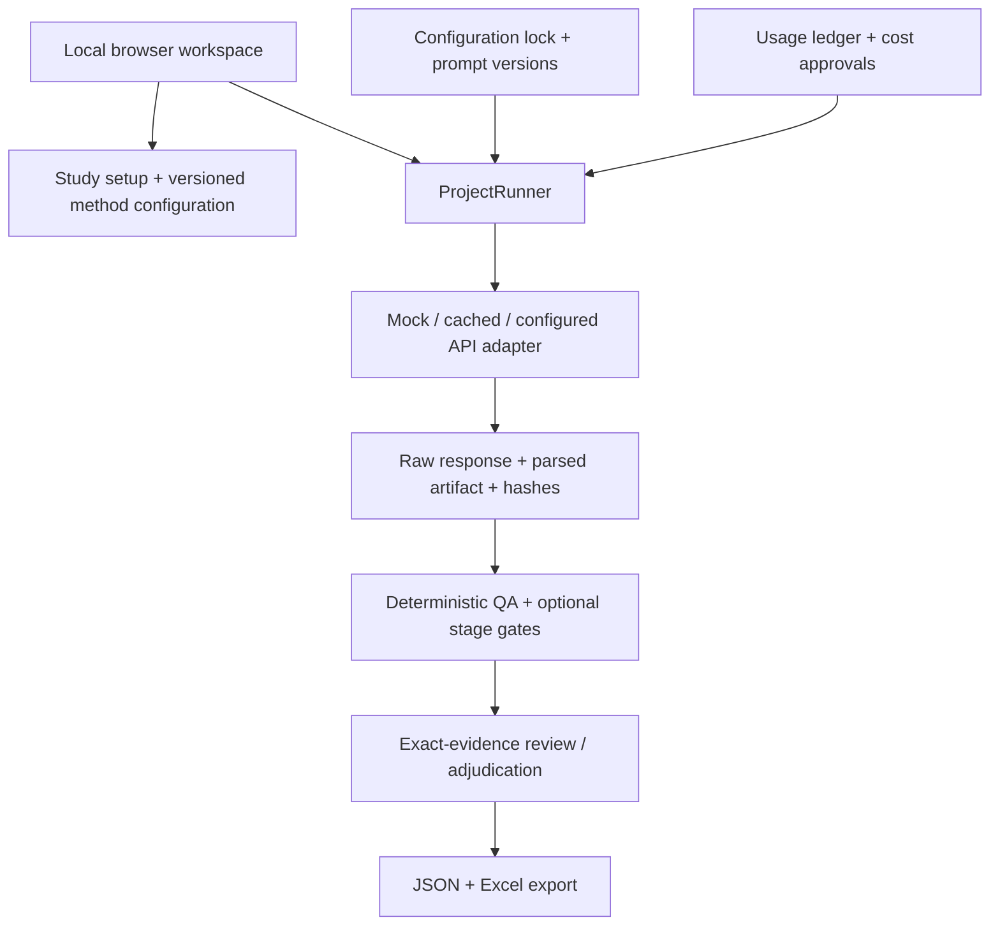

# Architecture

## Current implementation

QualFrame is a local-first browser interface over an authoritative Python workflow engine. File-backed artifacts and append-only review records are the source of truth. SQLite, hosted accounts, and multi-user authorization are not implemented.

The diagram shows component relationships, not a claim that all paths are available from the browser. External API execution remains CLI-only; the browser starts only managed mock/cached jobs.

## Module map

| Responsibility | Source |
| --- | --- |
| Study creation and non-overwriting imports | [study_setup.py](../src/qualframe/study_setup.py) |
| Typed contracts and configuration | [models.py](../src/qualframe/models.py), [config.py](../src/qualframe/config.py) |
| Versioned configuration fingerprints | [configuration_lock.py](../src/qualframe/configuration_lock.py) |
| Planning, staged execution, filters and resume | [project_runner.py](../src/qualframe/pipeline/project_runner.py) |
| Provider boundary | [providers/](../src/qualframe/providers/) |
| Usage, estimates, ceilings and approval pauses | [cost_control.py](../src/qualframe/cost_control.py) |
| Evidence materialization and review history | [evidence_review.py](../src/qualframe/evidence_review.py) |
| Local HTTP routes and actions | [dashboard.py](../src/qualframe/dashboard.py) |
| Shared interface shell and responsive styling | [workspace_ui.py](../src/qualframe/workspace_ui.py), [workspace.css](../src/qualframe/static/workspace.css) |

## Source-to-decision lineage

Imported sources are copied, hashed, and registered. A generic evidence record connects source identity and exact offsets to a code assignment, context, raw artifact, prompt hash, run, and configuration fingerprint. Source text and context are distinct.

Original-file hashes protect imported bytes; evidence-span hashes validate the extracted text addressed by character offsets. These are separate identities for Windows-line-ending text and Word documents. Both hashes are retained in reviewed exports.

An accept, edit, reject, or defer action appends reviewer identity, rationale, and decision. Edits create derived span/assignment records; they do not rewrite the transcript, provider output, or prior actions. Reviewed-evidence export requires a non-deferred action for every record. It packages evidence, review history, hashes, and bounded methods metadata—not findings.

Legacy CFIR tables do not supply canonical offsets. The generic evidence reviewer therefore must not be described as validated across the complete CFIR pathway.

## Execution and control boundaries

- YAML files separate framework, method, pipeline, prompt set, provider, review, analysis, and cost settings.
- A configuration fingerprint records selected assets; it is not proof of completed calibration.
- CFIR defaults to six per-domain calls. Generic full-codebook and top-level-category policies change the actual fan-out.
- Stage gates are enforced only when the project opts in. An annotated pipeline gate alone does not stop execution.
- Post-parse schema validation is optional and distinct from provider-native constrained generation.
- Cost-controlled runs require an exact model/pricing pair; estimates crossing a ceiling fail closed and unapproved interval crossings pause before the request.
- Cost-control machinery exists, but the public pricing snapshot is mock-only and email delivery has not been live-verified.

## Interface choices

The public interface uses a shared, dependency-free, server-rendered shell: system fonts, no external assets or tracking, keyboard-focus styles, mobile breakpoints, and explicit data/provider labels. The evidence screen separates source/context, coding proposal, reviewer action, queue, and provenance. Numeric offset editing remains the supported edit mechanism; direct text selection is planned.

The local server is a development-grade, single-user HTTP server bound to `127.0.0.1`. It is not authenticated or hardened for network deployment.

## Demonstration paths

- `scripts/run_workspace_demo.py`: fresh synthetic managed study, real mock runner, four exact-evidence records, interactive review/export.
- `scripts/run_interview_demo.py`: five-stage CFIR flow with synthetic cached responses, deliberate QA conflict, and Excel exports.

Both exercise real engine paths without external API calls. Neither evaluates model quality. See [verification](verification.md), [capabilities](capability_status.md), and [evaluation](model_evaluation_and_cost_control.md).
