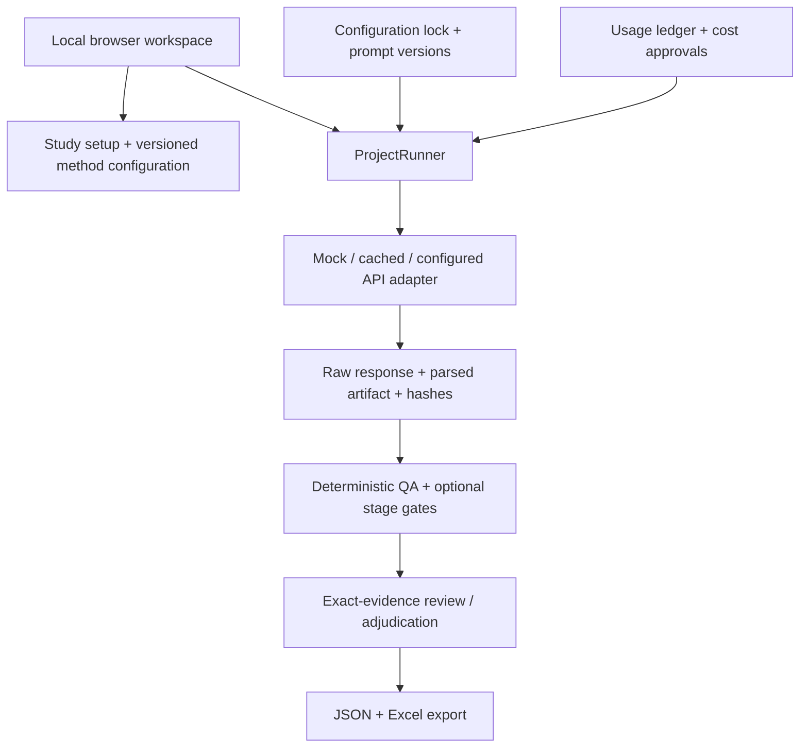

# Architecture

Focused review presentation lives in `review_ui.py` and a packaged browser script. `cfir_review.py` derives CFIR review records and a parent-qualified catalog; `cfir_import.py` preserves workbook versions. New run locks hash the reference workbook. Review indexes retain their codebook catalog and edits retain original source offsets. See decision 0008.

## Current implementation

QualFrame is a local-first browser interface over an authoritative Python workflow engine. File-backed artifacts and append-only review records are the source of truth. SQLite, hosted accounts, and multi-user authorization are not implemented.

The diagram shows component relationships. The browser can start managed mock/cached jobs and explicitly approved, cost-gated OpenAI/Anthropic coding and reviewed-synthesis jobs. Synthetic browser/API paths have been exercised; fresh real-transcript browser-upload validation remains separate from the private developer-operated CFIR pilot.

## Module map

| Responsibility | Source |
| --- | --- |
| Study creation and non-overwriting imports | [study_setup.py](../../src/qualframe/study_setup.py) |
| Typed contracts and configuration | [models.py](../../src/qualframe/models.py), [config.py](../../src/qualframe/config.py) |
| Versioned configuration fingerprints | [configuration_lock.py](../../src/qualframe/configuration_lock.py) |
| Planning, staged execution, filters and resume | [project_runner.py](../../src/qualframe/pipeline/project_runner.py) |
| Provider boundary | [providers/](../../src/qualframe/providers/) |
| Usage, estimates, ceilings and approval pauses | [cost_control.py](../../src/qualframe/cost_control.py) |
| Immutable final-manifest QA and legacy queue reading | [qa/inventory.py](../../src/qualframe/qa/inventory.py) |
| Evidence materialization and review history | [evidence_review.py](../../src/qualframe/evidence_review.py) |
| Local HTTP routes and actions | [dashboard.py](../../src/qualframe/dashboard.py) |
| Shared interface shell and responsive styling | [workspace_ui.py](../../src/qualframe/workspace_ui.py), [workspace.css](../../src/qualframe/static/workspace.css) |

## Source-to-decision lineage

Imported sources are copied, hashed, and registered. A generic evidence record connects source identity and exact offsets to a code assignment, context, raw artifact, prompt hash, run, and configuration fingerprint. Source text and context are distinct.

Original-file hashes protect imported bytes; evidence-span hashes validate the extracted text addressed by character offsets. These are separate identities for Windows-line-ending text and Word documents. Both hashes are retained in reviewed exports.

An accept, edit, reject, or defer action appends reviewer identity, rationale, and decision. Edits create derived span/assignment records; they do not rewrite the transcript, provider output, or prior actions. Reviewed-evidence export requires a non-deferred action for every record. It packages evidence, review history, hashes, and bounded methods metadata—not findings.

Legacy CFIR tables do not supply canonical offsets. The CFIR adapter derives review records only through declared source/label rules, retaining missing or ambiguous matches for correction. Source anchoring does not establish semantic validity across the complete CFIR pathway.

## Execution and control boundaries

- YAML files separate framework, method, pipeline, prompt set, provider, review, analysis, and cost settings.
- A configuration fingerprint records selected assets; it is not proof of completed calibration.
- CFIR defaults to six per-domain calls. Generic full-codebook and top-level-category policies change the actual fan-out.
- Stage gates are enforced only when the project opts in. An annotated pipeline gate alone does not stop execution.
- Post-parse schema validation is optional and distinct from provider-native constrained generation.
- Opt-in stage contracts can select framework QA rules, exact columns and allowed/required row values. Omitted QA selection preserves legacy framework-wide behavior; see [CFIR stage contracts](cfir_stage_contracts.md).
- Cost-controlled runs require an exact model/pricing pair; estimates crossing a ceiling fail closed and unapproved interval crossings pause before the request.
- Paid configurations retain dated model-specific pricing snapshots. Unknown usage blocks ordinary execution; explicitly opted-in developer recovery requires documented conservative holds. Email delivery has not been live-verified.

The opt-in CFIR v2 contract is hashed in configuration locks; scoped artifacts also
retain a hash of the typed contract. Before plan writes or execution, scoped resume
checks existing plan/lock/manifest bindings and stage artifact contracts. Incompatible
or unbound legacy artifacts require a new run ID. Raw artifacts and historical
manifests are not migrated. V2 remains offline-tested only: five network determinant
domains and Innovation-only cross-network synthesis under the preserved prompts.

## Interface choices

The public interface uses a shared, dependency-free, server-rendered shell: system fonts, no external assets or tracking, keyboard-focus styles, mobile breakpoints, and explicit data/provider labels. The evidence screen separates source/context, coding proposal, reviewer action, queue, and provenance. Direct text selection and numeric source offsets support evidence edits while preserving original proposals.

The local server is a development-grade, single-user HTTP server bound to `127.0.0.1`. It is not authenticated or hardened for network deployment.

## Demonstration paths

- `scripts/run_workspace_demo.py`: fresh synthetic managed study, real mock runner, four exact-evidence records, interactive review/export.
- `scripts/run_interview_demo.py`: five-stage CFIR flow with synthetic cached responses, deliberate QA conflict, and Excel exports.

Both exercise real engine paths without external API calls. Neither evaluates model quality. See [verification](verification.md), [capabilities](capability_status.md), and [evaluation](model_evaluation_and_cost_control.md).

## September 7 implementation increment

Excel codebook import is implemented with worksheet/header selection, column mapping, structural preview, explicit activation, original workbook retention, and conversion hashes. See [import guide](excel_codebook_import.md) and [checkpoint](development_checkpoint_2026-09-07.md). Live-provider browser execution and statistical comparisons remain pending.

## Provider preparation increment

Provider/model, standard output settings, dated pricing, spending ceiling, and governance confirmation can now be saved through the local interface. Session-only credentials are excluded from persistent study files. Original and revised project configurations are retained; a changed configuration invalidates old preflight plans. Browser requests reject unexpected Host/Origin values. Unknown provider names fail rather than substituting mock output. New generic studies reference complete review. Live browser execution, reasoning/effort settings, retry accounting, and live validation remain pending.

## Paid-execution increment — September 7, 2026

Supersedes earlier pending statements about browser provider execution, effort controls and attempt accounting: OpenAI/Anthropic paid browser dispatch is implemented with explicit current-plan approval, session-key checks and one active app job. OpenAI Responses/reasoning effort and Anthropic effort controls are versioned and retained in the editor. Automatic retries are disabled for these two adapters; durable request reservations, unresolved-usage blocking, completion-status capture, and audited command-line reconciliation are implemented. See [paid execution](paid_execution.md).

Offline verification: 130 tests passed, one skipped; both synthetic demos passed (five-stage cached CFIR with nine Excel exports, generic mock study with four valid evidence records). Current live API behavior remains unverified. Two synthetic preflights are prepared with separate USD 0.50 ceilings, pending owner approval and keys. No spending or publishing occurred. macOS execution, an installed-user trial, and the scientific benchmark remain pending.

## Exact-quotation contract — September 8

New generic studies now use a version 2 exact-quotation contract. Unique matches produce source-validated automatic spans; repeated/missing matches remain flagged. Raw model locations and the artifact's contract are retained, and the reviewer sees the location method. Existing v1 evidence is not repaired retroactively. See [decision 0007](../decisions/0007-exact-quotation-anchoring.md).

The two remaining approved live calls completed: each provider returned two uniquely anchored source-valid coding rows. Across v1 and v2, four successful coding calls cost USD 0.0050812 in recorded token charges (OpenAI USD 0.0016042; Anthropic USD 0.003477). No more live calls were sent. These tiny synthetic checks validate this software path, not agreement/stability or qualitative accuracy. Live evidence is left unreviewed for the owner to inspect.

Study progress is a read-only projection in study_progress.py of the selected run plan, manifest-listed coding artifacts, source hashes, and latest evidence actions. Coding completion is independent of proposal counts. The UI does not infer transcript-level failure causes when no successful artifact exists.

Reviewed analysis: reviewed_analysis.py builds read-only payloads from frozen run inputs and latest append-only decisions, validates source/artifact/record hashes and exact spans, and writes content-addressed snapshots only on explicit freeze. analysis_ui.py renders snapshot versions and evidence-linked matrix cells. Snapshots are independent of mutable live review and later differences are flagged.

## Reviewed synthesis preparation and raw comparison — September 10

`synthesis_plan.py` constructs immutable inputs from a current reviewed snapshot,
records source scope/exclusions and file-backed versioned instructions, and
validates citation membership for the future summary contract. It has no provider
dispatch. `synthesis_ui.py` exposes preparation and instruction inspection.

`run_comparison.py` rechecks frozen run/codebook/source/artifact identities and
compares original indexed proposals independently of append-only human decisions.
It uses code sets, exact span tuples, and merged per-code character intervals.
Excluded and absence proposals remain explicit. `comparison_ui.py` exposes scores,
code breakdowns, differing exact quotations and frozen JSON reports. The working
`qualframe-eval compare` command shares that implementation; older evaluation
commands remain scaffolds. See [comparison protocol](raw_run_comparison_protocol.md).

Subset evidence snapshots record included and excluded source paths. Freshness
uses the selected scope; decisions on excluded transcripts do not change it.

## Reviewed synthesis execution and review — September 10

`synthesis_execution.py` rebuilds and checks a prepared plan against its current
reviewed snapshot, previews cost with the same allowance used by reservations, and
writes an isolated synthesis job under the coding run. It reuses `_complete` for
attempts, no retries, usage and completion checks. Per-call schema constraints are
passed only for synthesis; existing coding prompts and outputs are preserved.
`synthesis_review.py` validates stored identities, writes append-only statement
choices and exports a content-addressed reviewed result with complete review history.
`synthesis_workspace.py` provides background start, status and focused statement
review. Source changes block new summary decisions/export but preserve history.
The schema and provider configuration are frozen in each execution record.

Browser tests also exposed and fixed native-form validation blocking rejection of
invalid evidence offsets, and a restarted incomplete request being labeled as an
untouched dry-run plan. Request records now retain safe error type/cause codes.

## September 11 review and evaluation increment

`empty_output_review` recognizes only explicit valid empty tables that satisfy the frozen output contract and expected partitions. Source-level decisions are append-only, bound to source/artifact/plan/index hashes, and retained in reviewed snapshots separately from code-level absence and rejection. Malformed or unparsed outputs remain incomplete.

`metadata_synthesis` resolves imported CSV records to registered source paths, freezes field/value/missing-policy definitions and full local metadata identity, and supplies reviewed-evidence group matrices. Metadata plans use v2 while existing v1 plans and completed jobs remain usable. Execution revalidates metadata membership; provider inputs omit unrelated metadata columns.

`repeat_execution` freezes a coding stage, cohort, configuration and request hashes, then executes separate runs sequentially against the shared ledger. Durable attempts and completion receipts, an OS-held experiment lock, explicit resume, and unresolved-usage blocking preserve prior work. `repeat_comparison` retains all planned runs, incompatible pairs and undefined metrics. Browser Save binds the displayed report identity; frozen reports are content-addressed. See [repetition](repeated_coding.md) and [report protocol](repeat_comparison_protocol.md).

## Span benchmark layer

`benchmark_metrics.py` is a pure deterministic scorer over source-validated raw comparison payloads. It keeps exact and thresholded maximum-cardinality one-to-one matches in a separate versioned report, with per-code/source support, unmatched IDs, duplicate and exclusion diagnostics. `benchmark_inputs.py` provides an explicit historical CFIR/source-mapping adapter; it does not supply human references or infer historical configuration equality. `benchmark_reporting.py` writes immutable content-addressed HTML/JSON/CSV bundles. The `qualframe-eval benchmark` command and `/benchmark` browser view expose the local calculation without provider calls; browser saving binds the displayed report identity to current inputs.

Matching thresholds are methodological choices, not validated quality thresholds. Public examples/tests remain synthetic, and private benchmark inputs/results stay in ignored artifact folders.

September 11 interrupted-request recovery: `CostController` now separates recorded usage from budget exposure. An append-only, reservation-hash-bound conservative hold can be used only by an explicitly opted-in continuation. Default execution still blocks unresolved requests. Reconciliation preserves and supersedes the held exposure without fabricating token usage; see `paid_execution.md`.

## QA inventory after resumed execution

At finalization, `ProjectRunner` evaluates QA once for each unique artifact path included in that invocation's manifest. Stored structured-output failures, directed-method policy checks and framework QA contribute separate findings. Stage/transcript filters retain their current scope; unrelated disk artifacts are not silently added. Schema stage gates remain enforced under the configured policy.

`qa/inventory.py` writes an immutable inventory containing artifact hashes, stable item IDs and hashed review paths. The manifest binds its inventory path and hash. Generated IDs include the source artifact identity and failure occurrence so duplicate-looking rows or separate stages/sources remain distinct. Reading a declared inventory verifies its scope, payload identities and file hashes; malformed declarations fail rather than falling back silently.

The dashboard and demo read this inventory through a central helper. Old manifests with neither inventory field retain flat-file behavior. Existing explicit inventory bindings and uniquely source-bound legacy schema/method findings can retain their review paths and decision IDs. Anonymous legacy findings remain unassociated history; a matching message alone cannot transfer a decision to another source. Raw artifacts, old review files, append-only decisions and frozen reviewed snapshots are not rewritten by the repair. Independent disagreement records remain visible outside the engine QA count.

## Private reference-pipeline test scope

The completed configured test sequence joins 12 source/stage outputs across three frozen configuration versions: 24k/medium coding and roll-ups, one 48k/medium context output, and five 48k/low downstream outputs. A separate composite receipt preserves each original run/configuration/artifact identity; copied upstream dependencies are not relabelled as newly generated child outputs. The two predecessor runs remain incomplete. This path consumes raw model artifacts under a test-only acceptance assumption, distinct from reviewed-snapshot synthesis and its provider-native response schema.

The preserved network prompt specifies five CFIR domains and excludes Outcomes Addendum; the final cross-network prompt explicitly targets Innovation only. Completing these configured calls does not establish synthesis across all domains.

The preserved QA flags reflect a rule-applicability mismatch: global coding-column requirements were applied to synthesis tables, and a cross-network source/valence rule was applied to network tables. Generated headers matched the preserved stage prompts. The raw flags remain in the private audit; their count is not a semantic-error rate or evidence of schema validation. The QA inventory repair preserves those findings and does not silently change the rules. The existing optional stage-schema specification also needs alignment with the synthesis prompts; it was disabled in this pilot. Version stage-specific QA and schema contracts to match the preserved stage prompts, then plan explicit domain scope for any broader synthesis before further research synthesis. Preserve existing prompts/results; any all-domain extension requires a separately declared prompt/pipeline version.

The private receipt inventories all 32 attempts, 12 exports, full-composite QA and shared cost exposure. It is a completion/audit artifact, not human review or a single-configuration research result. Private HTTP/2 continuation helpers and verified terminal-tier exposure accounting are scoped to this approved pilot; general browser recovery remains pending.

## Offline archival and synthesis preparation

`archival_reference.py` imports a manifest bound to source-file, extracted-text,
reference-file and frozen-codebook hashes. It retains original reference locators,
modern source offsets, declared historical assisted-review provenance and every
included, excluded or out-of-scope record. `archival_quote_alignment.py` produces a
separate model-input conversion using the same case-sensitive exact/typographic/
whitespace policy; original payloads and transformation outcomes remain attached.

`archival_comparison.py` requires matching cohorts, source identities, full
codebooks and quotation policies. It projects literal same-domain parent codes
and uses deterministic maximum-cardinality one-to-one matching on overlap divided
by shorter span length. Exact/IoU comparisons are separate boundary sensitivities.
Different quotation policies require an explicitly identified sensitivity. These
reports estimate concordance with selected archived evidence, not independent
human accuracy or original coded-boundary correctness. No review events are
created. Real inputs and reports remain private; these helpers have no browser
import endpoint. See [archival import](archival_reference_import.md).

`cfir_synthesis_preparation.py` creates a separate content-addressed plan from
explicit, same-run network artifacts, a frozen catalog and an input-provenance
statement. The new file-backed v2 prompt produces one prepared request for each
selected core CFIR domain with domain/network/schema bindings. Local response
validation uses the v2 structural contracts. The module contains no dispatcher or
funding authorization and does not change the Innovation-only legacy runner.
See [cross-domain preparation](cfir_cross_domain_preparation.md).

The release packager screens exactly the selected archive members, including
links and optional private fingerprints. The isolated preflight verifies those
member hashes, installs a wheel, exercises cached/mock demos, and starts/stops/
restarts its own loopback app against the same synthetic study. Nonces and owned
process identifiers distinguish Windows virtual-environment launchers from app
workers. Source drift after packaging invalidates a current-checkout equivalence
claim; a tested archive retains its own receipt. See
[release verification](release_verification.md).
